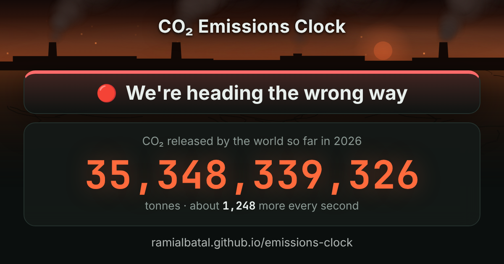

# Emissions Clock



**Live site: https://ramialbatal.github.io/emissions-clock/**

A static, real-time "debt clock" style page estimating **CO₂** and **methane** emissions for the world and major emitters.
A switch at the top changes gas. `#methane` in the URL opens the methane view directly.

**Languages:** English, French, Spanish and Arabic. The globe at the top switches language; `?lang=fr`, `?lang=es` or
`?lang=ar` opens one directly. Translations live in `js/i18n/`; corrections from native speakers are very welcome.

**What can I do?** A button under the answer opens three evidence-based actions, each with its source (`js/actions.js`).

**Privacy:** visits are counted anonymously with [GoatCounter](https://www.goatcounter.com/) (no cookies, no
personal data). The link-preview picture (`img/og-image.png`) is refreshed every Monday by a GitHub Action
(`npm run og-image`), so shared links show that week's answer and number.

**On your own website:** the "Put this clock on your website" button at the bottom gives a one-line code for a small
live widget (the answer and the counter), in the language and view you have open. The widget is the same page with
`?embed=1`.

Serve the folder with any static server (`npm run serve`, then open http://localhost:8000) or any static host (it's
live on GitHub Pages). There's no build step. Opening `index.html` straight from disk won't work: browsers block ES
modules on `file://` pages.

## Data

On load, the page fetches the latest official annual figures in the browser, straight from
[Our World in Data's grapher API](https://ourworldindata.org/co2-emissions), which allows cross-origin requests.
Each gas is fetched the first time it's shown, with a spinner while it loads:

| Gas | Source | Covers | Unit |
|---|---|---|---|
| CO₂ | Global Carbon Project, *Global Carbon Budget* | fossil fuels + cement, excl. land use | t CO₂ |
| Methane | Jones et al., *National contributions to climate change* | all human sources incl. agriculture & land use | t CO₂e (100-yr) |

Gases, countries, the trend window, the growth cap and the carbon budget are configured in `js/config.js`.

## Method

The latest reported year is projected to the current year using each country's latest year-on-year change
(`trendYears` in `js/config.js`; set it higher to average over several years), capped at 20% a year (`maxGrowth`). That total is spread evenly
across the year, so the counters show year-to-date emissions ticking in real time. This is a model, not a live measurement.

## Carbon budget bars

Below the world counter, three bars show how much of the 1.5°C, 1.7°C and 2°C carbon budgets left at the time of the
Paris Agreement (2016) has been used, ticking live, and when each runs out at today's rate. Remaining budgets come from
the Global Carbon Budget 2026 key messages (150, 510 and 1035 GtCO₂, 50% likelihood, counted from the start of 2027);
emissions used are total CO₂ including land-use change, fetched from Our World in Data. A "Paris pace check" compares
this year's emissions with a straight-line path to the IPCC's 48% cut from 2019 to 2030. Settings are under `budget` in `js/config.js`.

**Yearly update:** each November the Global Carbon Project publishes a new edition. Update `budget.thresholds`,
`budget.from`, `budget.source`, `budget.sourceUrl` and the comment above them in `js/config.js` with the new remaining
budgets, and the edition and figures in the paragraph above (the page names the edition it uses).

## Run it and check it

```sh
npm run serve        # then open http://localhost:8000
npm install          # dev tools only: TypeScript checker, Playwright, clock-core (types and tests)
npm run check        # house style + types + unit tests
npx playwright install chromium   # once, for the smoke test
npm run smoke        # real browser, real data, desktop and phone
```

Settings live in `js/config.js`, calculations in `js/model.js` (unit tested), page code in `js/app.js`, the picture behind the header in `js/scene.js`. Shared helpers
and styles come from [clock-core](https://github.com/ramialbatal/clock-core), pinned to an exact commit in `index.html` and `package.json`.
How the clocks are built, lessons learned and rules for new code: [developer notes](https://github.com/ramialbatal/clock-core/tree/main/docs).

## Contributing

Ideas, fixes and new data sources are welcome: see [CONTRIBUTING.md](CONTRIBUTING.md). Part of
[AI for things that matter](https://ramialbatal.github.io/), alongside the
[Emissions](https://github.com/ramialbatal/emissions-clock), [Renewables](https://github.com/ramialbatal/renewables-clock)
and [Jobs](https://github.com/ramialbatal/jobs-clock) clocks.

## Licence

Code: [MIT](LICENSE). Data is fetched live from its publishers and stays under their licences:

| Source | Used for | Licence |
|---|---|---|
| Global Carbon Project, Global Carbon Budget | national and world CO₂, carbon budgets | CC BY 4.0 |
| Jones et al., National contributions to climate change | methane in CO₂-equivalents | CC BY 4.0 |
